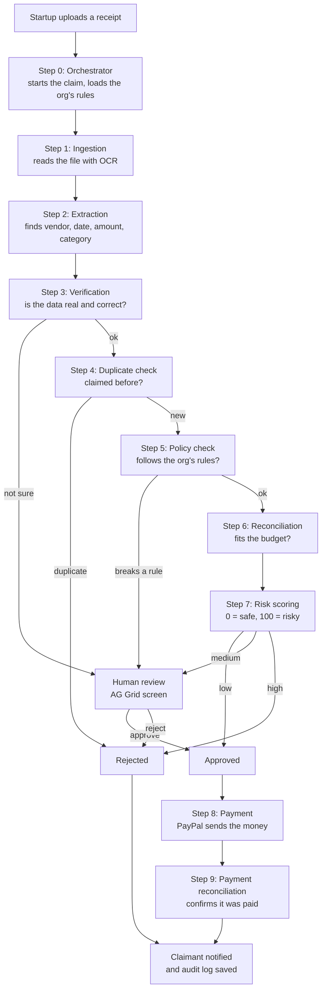

# ReimburseAI — MVP Agentic Flow

*AI-Augmented Reimbursement Automation SaaS*

**In one sentence:** A startup uploads a receipt, a team of AI agents checks it step by step, and if everything is fine the money is paid through PayPal. A human only steps in when something looks wrong.

---

## 1. The flow at a glance

```
Upload → Read → Extract → Verify → Duplicate check → Policy check → Reconcile
       → Risk score → Approve / Human review / Reject
       → Pay via PayPal → Confirm payment → Notify + audit log
```

---

## 2. Flow diagram



---

## 3. Each step in simple words

| # | Agent | What it does |
|---|---|---|
| 0 | **Orchestrator** | The "manager". Starts the claim, loads the organization's rules, and passes the claim to each agent in order. |
| 1 | **Ingestion** | Opens the uploaded PDF or photo and turns it into text (OCR). |
| 2 | **Extraction** | AI pulls out the key details: vendor, date, amount, tax, currency, category. |
| 3 | **Verification** | Checks the details make sense: totals add up, the date is valid, the receipt doesn't look edited. If the AI isn't sure, a human checks. |
| 4 | **Duplicate check** | Makes sure the same receipt wasn't already claimed (same file or very similar details). |
| 5 | **Policy check** | Compares the claim with the organization's rules, e.g. "meals max $50" or "receipt needed above $25". |
| 6 | **Reconciliation** | Checks the claim fits the startup's budget or grant, and matches real bank/card transactions when available. |
| 7 | **Risk scoring** | Combines all checks into one score from 0 (safe) to 100 (risky), with the reasons. |
| 8 | **Payment** | Sends the money to the claimant through PayPal. |
| 9 | **Payment reconciliation** | Waits for PayPal to confirm, then marks the claim as paid and updates the records. If payment fails, an admin is alerted. |

**After every claim:** the claimant is notified, and every decision (by AI or by a human) is saved in an audit log.

---

## 4. How a claim gets approved

| Risk score | What happens |
|---|---|
| 0–30 (low) | Approved automatically |
| 31–70 (medium) | Sent to a human reviewer |
| 71–100 (high) | Rejected, with the reason shown to the claimant |

> These numbers are examples. Each organization sets its own.

---

## 5. Human review (AG Grid screen)

Only flagged claims reach a person. The reviewer sees them in a smart, spreadsheet-like table:

- Sorted by risk, riskiest first
- Shows the extracted details and **why** the claim was flagged
- Reviewer can fix values, then approve or reject — one by one or in bulk

---

## 6. Example

A startup uploads a **$45 taxi receipt**:

1. **Ingestion** reads the photo.
2. **Extraction** finds: City Cabs, 3 Nov 2026, $45, Travel.
3. **Verification** — total and date look correct.
4. **Duplicate check** — not claimed before.
5. **Policy check** — travel limit is $100, so it's OK.
6. **Reconciliation** — the startup has $800 left in its travel budget.
7. **Risk scoring** — score 12 (low), so it's **auto-approved**.
8. **Payment** — PayPal sends $45 to the startup.
9. **Payment reconciliation** — PayPal confirms; the claim is marked **PAID** and the startup is notified.

Total human effort: **zero**.

---

## 7. Who's involved

| Who | Role |
|---|---|
| Claimant (startup) | Uploads receipts, tracks status |
| AI agents | Do all the checking |
| Reviewer (incubator / investor finance team) | Handles only flagged claims |
| Admin | Sets the organization's rules, limits and thresholds |
| PayPal | Sends the money |

---

## 8. Claim status

| Status | Meaning |
|---|---|
| SUBMITTED | Receipt uploaded |
| PROCESSING | AI agents are checking it (steps 1–7) |
| IN_REVIEW | Waiting for a human |
| APPROVED | OK to pay |
| REJECTED | Not paid; reason shared with the claimant |
| PAYING | Payment sent to PayPal |
| PAID | PayPal confirmed the payment |
| PAYMENT_FAILED | PayPal payment failed; admin alerted |

---

## 9. Multiple organizations (multi-tenant)

Each organization (incubator, investor, company, etc.) gets its own:

- Expense rules and limits
- Risk thresholds
- Approvers
- Separate, private data

---

## 10. Suggested MVP tech

| Part | Tech |
|---|---|
| Frontend | Next.js + AG Grid |
| Backend / agents | FastAPI (Python) or Node.js |
| OCR | Azure Document Intelligence or Tesseract |
| AI extraction | LLM with structured JSON output |
| Database | PostgreSQL + pgvector (for duplicate matching) |
| Payments | PayPal Payouts API (sandbox) |
